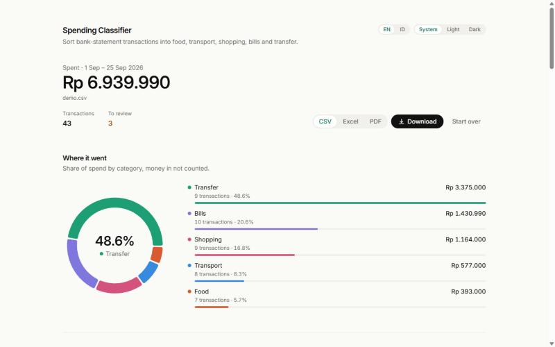
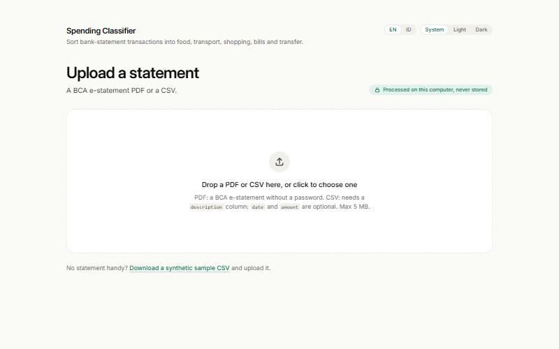
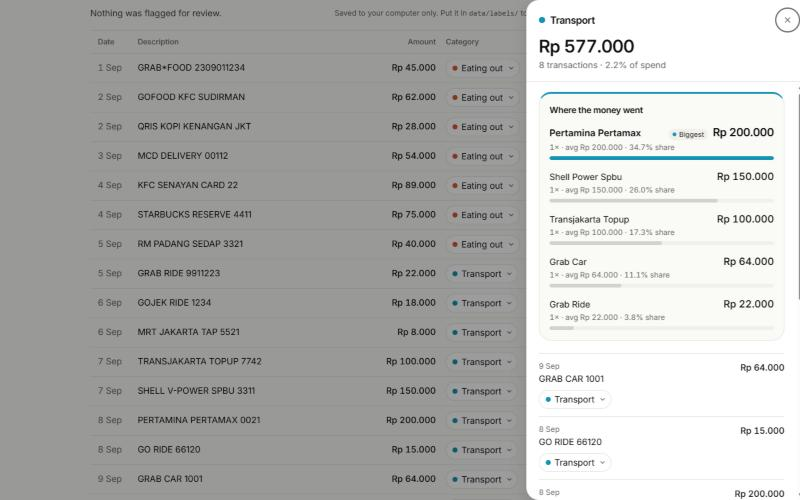
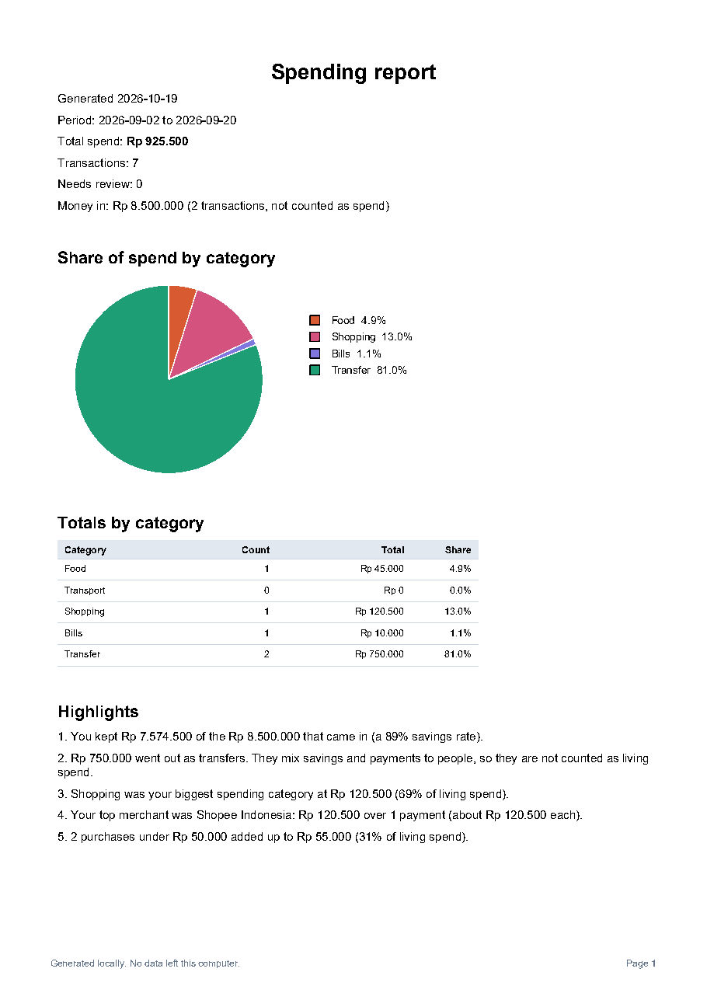
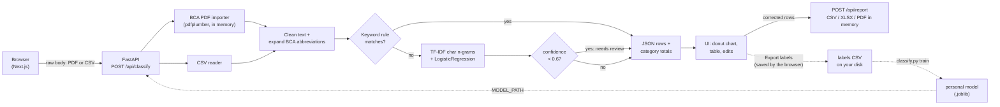

# Spending Category Auto-Classifier

**Privacy-first spending categorizer for Indonesian bank statements — runs 100% on your machine.**

[](https://github.com/rifkymol/spending-category-classifier/actions/workflows/ci.yml)


[](LICENSE)
[](PRIVACY.md)

Drop in a BCA e-statement PDF (or any CSV with a `description` column) and get every transaction sorted into **food, transport, shopping, bills or transfer**, a donut chart of where the money went, and a CSV, Excel or PDF report. Rows the model is unsure about are flagged for you to check, and your corrections can train a personal model. Nothing is uploaded anywhere: no database, no cloud, no analytics.



## Quickstart

You need [Docker Desktop](https://www.docker.com/products/docker-desktop/), running.

```bash
git clone https://github.com/rifkymol/spending-category-classifier.git
cd spending-category-classifier && docker compose up --build
```

Then open http://127.0.0.1:3000.

**Try it with the sample files:** upload [`data/sample_transactions.csv`](data/sample_transactions.csv) (40 made-up rows; the upload page also links a copy). A synthetic BCA e-statement PDF is generated on the fly by the test suite ([`backend/tests/bca_fixture.py`](backend/tests/bca_fixture.py)); no real statement is in the repo.

## Features

- **BCA e-statement PDF import**, parsed in memory with `pdfplumber` (multi-line descriptions, page breaks, DB/CR markers), plus generic CSV upload.
- **Two-stage classifier:** keyword rules for well-known merchants, then a TF-IDF + logistic regression model for the rest.
- **Review flags** on low-confidence rows (threshold 0.6), with a "Next to review" filter and one-click "Looks right".
- **Editable categories**, a donut chart and per-category totals; money coming in is shown but not counted as spending.
- **Spending insights:** cash flow and savings rate, top merchants, small-spend and fee callouts, a 50/30/20 view and what-if sliders, updated as you correct categories.
- **50/30/20 in Rupiah:** monthly targets for needs, wants and savings from your income (detected from money in, or typed in and never stored), with "Rp X left" / "Rp X over" per bucket.
- **Reports** as CSV, Excel (summary sheet with a chart, plus an Insights sheet) or A4 PDF (with a Highlights section), all built in memory.
- **Teach it your spending:** export your reviewed rows as labels and train a personal model from the CLI.
- **English and Bahasa Indonesia:** an EN | ID switch for the whole UI, the highlights, error messages and the Excel/PDF reports. It starts in your browser's language.
- **Light, dark or system theme** (System | Light | Dark switch, no flash on load), with a bundled font (no external fonts or CDNs).
- **Self-hosted and locked down:** localhost-only ports, read-only non-root containers, no outbound calls.

| Upload | Review | PDF report |
|---|---|---|
|  |  |  |

## How it works



1. The browser sends the file as the raw request body. The API detects a PDF by its content type (`application/pdf`) or its `%PDF-` magic bytes and parses it with the BCA importer; anything else is read as CSV.
2. Descriptions are lowercased, stripped of reference numbers, dates and noise, and BCA abbreviations are expanded ([`backend/classifier/bca.py`](backend/classifier/bca.py)).
3. Keyword rules (word-boundary regexes for public chain merchants) decide the obvious rows. Transfer rules run last.
4. The rest go to a TF-IDF model (`char_wb`, n-grams 2–5) plus logistic regression. A prediction below 0.6 confidence is flagged for review.
5. The UI shows the results; edits stay in the page. The report endpoint takes the corrected rows and streams back a file.
6. Optionally, "Export labels" saves your reviewed rows as a CSV, which the CLI turns into a personal model loaded through `MODEL_PATH`.

### Insights

The Insights panel under the chart turns one statement into budgeting figures. Everything is computed in memory from the current rows by `backend/classifier/insights.py` (rule-based statistics, no AI), and recomputed through `POST /api/insights` whenever you correct a category.

- **Cash flow:** money in (CR rows), total out, living spend (money out excluding transfers), transfers out, net, and the savings rate (net / money in; shown only when the statement has money-in rows, so not for CSV uploads).
- **Top merchants:** the top 5 by total and by count, with the average payment. Names come from the cleaned description minus BCA boilerplate and reference numbers. Transfers are left out, since they are usually people.
- **Small spends:** living-spend purchases under Rp 50,000, with their count, total and share of living spend.
- **Fees:** rows matching bank fee phrases (`biaya adm`, `biaya transfer`, `biaya bi fast`, `admin fee`).
- **50/30/20 view:** needs = bills + transport, wants = food + shopping. With an income it shows Rupiah targets per month (needs 50%, wants 30%, savings 20% of income), the actual amounts and the difference: "Rp 450.000 left" or "Rp 300.000 over" for needs and wants, "Rp X short of target" or "On track" for savings. The income is money in scaled to one month, or a monthly income you type into the card (CSV uploads have no money in); the typed value is sent with each insights and report request and never stored. Savings = income minus all money out, so transfers count as money out, not as savings; they are shown separately as unclassified, because they mix savings and payments. Without an income the card falls back to shares of total out.
- **What-if sliders:** cut a category by 0–50% and see the saving per month and per year, and how far the food and shopping cuts move wants toward its target. Figures are scaled per month from the statement period; a statement shorter than a month counts as one month.
- **Highlights:** 3–5 plain-English sentences ranked by Rupiah impact, also in the PDF report and the Excel Insights sheet.

The defaults (the Rp 50,000 threshold and the needs/wants mapping) are constants at the top of `insights.py`. These are budgeting insights, not financial advice: the app never suggests financial products or investments.

### Design decisions

- **Raw body instead of multipart.** Starlette spools multipart uploads over 1 MB to a temp file on disk. Sending the file as the raw request body keeps it in memory only, and a test proves it with a >1 MB upload against an isolated temp dir.
- **Rules before the model, transfer rules last.** Public merchant names are cheap, precise signals, so rules handle them with 1.00 precision on the sample. Transfer rules run last because a QR or debit payment to a known merchant also looks like a transfer.
- **Money in is not spending.** Credit (CR) rows are shown and kept in reports, but excluded from the spending totals and chart, so a salary doesn't look like a big "transfer" expense.
- **`pdfplumber` instead of an LLM with vision.** Text extraction gives exact amounts, runs offline, costs nothing and never sends a statement to a third party. An LLM could misread a digit and would need the document to leave the machine.
- **Labels are exported client-side.** The browser builds the labels file and you save it yourself, so the server stays storage-free and never holds your history.
- **Unreviewed model guesses are never training data.** Each label row carries `label_source` (`user`, `rule` or `model`); training drops `model` rows so the model can't learn from its own unchecked mistakes.
- **Formula injection is neutralized in reports.** Any text cell starting with `=`, `+`, `-`, `@`, a tab or a carriage return gets a leading `'`, so a crafted description can't run as a spreadsheet formula.
- **Everything is pinned.** Exact Python versions plus a full transitive lock, exact npm versions, and digest-pinned base images make builds reproducible and resistant to a hijacked upstream release.

### Results

Honest numbers, aggregate only, from one month of the author's own BCA statement (98 rows). The statement itself never left the author's machine.

| Model | Combined accuracy, all labeled rows (n≈96) | On the 44 rows the user had to correct or confirm | Review share at 0.6 |
|---|---|---|---|
| Shipped synthetic-only model | 56% (model-only 54%) | 4.5% | 46% |
| Personal model after one round of labeling (2-fold CV) | 100% (model-only 97%) | 100% | ~10% |

The synthetic model mostly fails on QR-merchant payments, which it has never seen. One round of labeling fixes that for this user.

**Caveats:** this is one month with few distinct merchants, and cross-validation within the same month is optimistic, because the same merchants appear in both folds. A true out-of-month test (train on September, test on October) is still pending. On the 40-row synthetic sample, 5-fold CV gives model-only 0.68 and combined 1.00 (rules cover 78% of rows there).

## Privacy

Bank statements are sensitive, so privacy is a feature, not an afterthought. Full details and how each guarantee is tested: **[PRIVACY.md](PRIVACY.md)**.

- **In memory only:** uploads and reports are never written to disk; there is no database.
- **Logs hold no transaction data:** only method, path, status, duration and row count.
- **No outbound calls:** no analytics, external fonts or CDNs; Next.js telemetry is off.
- **No financial data in browser storage:** the browser remembers only two UI preferences, `lang` and `theme`. A check script in CI fails on any other key or storage API.
- **Localhost only:** ports are published on `127.0.0.1`, so other devices on your network can't reach the app.
- **Locked-down containers:** read-only filesystem, non-root, all capabilities dropped, RAM-only `/tmp`.
- **Synthetic shipped model:** your labels and personal models stay local and gitignored.

## Teach it your spending

The bundled model only knows 40 synthetic rows, so merchants without a keyword rule often land in the wrong category. Train a personal model on your own reviewed transactions; it all happens on your machine.

1. Upload a statement and review it. Change wrong categories, or press **✓** ("Looks right") on a flagged row that is already correct. Then click **Export labels**: your browser saves `labels-YYYY-MM-DD.csv` (`date,description,amount,direction,category,label_source`).
2. Move the file into `data/labels/` (create it with `mkdir data/labels`).
3. Check how a model does on your labels (metrics only, no descriptions printed):
   ```bash
   .venv\Scripts\python backend/classify.py evaluate data/labels/*.csv
   ```
4. Train your personal model:
   ```bash
   .venv\Scripts\python backend/classify.py train data/labels/*.csv --model models/personal.joblib
   ```
5. Use it. For development, start the API with `MODEL_PATH=models/personal.joblib` (PowerShell: `$env:MODEL_PATH="models/personal.joblib"`). With Docker, put the file in `./models/`, uncomment the `environment` and `volumes` lines under `api` in `docker-compose.yml` (mounted read-only) and set `MODEL_PATH: /models/personal.joblib`.

Notes:

- `train` and `evaluate` keep only `user` and `rule` rows and print how many `model` rows they dropped.
- `train` accepts several files (add a new export each month) and also includes the synthetic sample unless you pass `--no-synthetic`. It prints counts per category, never descriptions.
- `evaluate` leaves categories with fewer than 2 rows out of cross-validation with a warning (`--min-per-class` raises the bar).
- Wildcards such as `data/labels/*.csv` work in PowerShell and cmd too; the CLI expands them itself.
- `data/labels/`, `models/` and `*.joblib` are gitignored and excluded from the Docker build.

## Development

### Run for development

Python 3.13 and Node.js 22. Run the API and the web UI as two local dev servers:

```bash
python -m venv .venv
.venv\Scripts\python -m pip install -r requirements.txt
.venv\Scripts\python -m uvicorn app.main:app --app-dir backend --host 127.0.0.1 --port 8000
```

In a second terminal:

```bash
cd frontend && npm install && npm run dev
```

Open http://127.0.0.1:3000. On macOS or Linux, use `.venv/bin/python`. `requirements.txt` installs the runtime packages from `backend/requirements-runtime.txt` plus `pytest` and `httpx`; the Docker image installs the runtime file only. To point the UI at another API address, copy `frontend/.env.example` to `frontend/.env.local` and set `NEXT_PUBLIC_API_URL`. For a production build, use `npm run build` and `npm run start`; both bind to `127.0.0.1`.

On startup the API trains a model in memory on the synthetic `data/sample_transactions.csv`, or loads the joblib file named by `MODEL_PATH`. No files are written either way.

### API

| Endpoint | What it does |
|---|---|
| `GET /api/health` | `{"status": "ok", "model": "synthetic" or "custom"}` |
| `POST /api/classify?threshold=0.6&lang=en` | `lang` (`en` or `id`, default `en`; anything else is English) sets the language of the highlights, disclaimer and error messages here and on the two endpoints below. Body: a BCA e-statement PDF (`application/pdf`) or a CSV (`text/csv`, or `application/octet-stream`, which is treated as CSV unless it starts with `%PDF-`) with a `description` column (`date` and `amount` optional), max 5 MB. Returns rows with `predicted`, `confidence`, `needs_review` and `source` (`rule` or `model`), plus per-category totals. |
| `POST /api/insights?lang=en` | Body: `{"rows": [...], "income_override": 8000000}`, same as `/api/report` (same caps and validation). `income_override` is optional: a monthly income (a finite number from 0 to 10^12; 0 or missing means use money in) for the 50/30/20 Rupiah targets. Returns the insights for those rows: cash flow, top merchants, small spends, fees, the 50/30/20 view, per-month figures and highlights. `/api/classify` includes the same `insights` for the uploaded rows. |
| `POST /api/report?format=csv&lang=en` | Body: `{"rows": [...], "income_override": 8000000}` (rows from `/api/classify`, with any corrected `predicted`; the income is optional, as above). `format` is `csv` (default), `xlsx` or `pdf`. Excel and PDF follow `lang`; CSV is a machine format and stays English. Capped at 10 MB and 50,000 rows. Validation errors return 422 with field locations only, never the submitted rows. |

```bash
curl -X POST --data-binary @data/sample_transactions.csv -H "Content-Type: text/csv" http://127.0.0.1:8000/api/classify
```

### CLI

```bash
python backend/classify.py evaluate data/sample_transactions.csv   # CV accuracy, rule coverage, review share
python backend/classify.py train data/sample_transactions.csv      # saves backend/models/model.joblib
python backend/classify.py predict data/sample_transactions.csv --out data/predictions.csv
```

`predict` also takes a BCA PDF and needs no `category` column. Use `--threshold` (default 0.6) to change when rows are flagged.

### Tests

```bash
.venv\Scripts\python -m pytest backend/tests -q -p no:cacheprovider
```

190 tests cover the pipeline, the BCA importer (against a synthetic `reportlab` PDF), the API, reports, insights and 50/30/20 targets, both languages, and the privacy rules (no files written during an upload, no row data in logs). The frontend is checked with `npm run check:i18n` (English and Indonesian have the same keys and placeholders), `npm run check:storage` (only `lang` and `theme` in browser storage), `npm run lint`, `npx tsc --noEmit` and `npm run build`. CI runs all of this plus `docker compose build` on every push and pull request ([`.github/workflows/ci.yml`](.github/workflows/ci.yml)).

### Project structure

```text
.
├── backend/
│   ├── app/              FastAPI app: main.py (endpoints), reports.py, schemas.py
│   ├── classifier/       pipeline.py (clean, rules, model), insights.py, bca.py, importers/bca_pdf.py
│   ├── tests/            pytest suite and the synthetic BCA PDF fixture
│   ├── classify.py       CLI: evaluate, train, predict
│   ├── Dockerfile
│   └── requirements*.txt / requirements-runtime.lock
├── frontend/
│   ├── src/              Next.js App Router page, components, lib
│   ├── public/           sample.csv (synthetic)
│   └── Dockerfile
├── data/                 sample_transactions.csv (synthetic); raw/ and labels/ are gitignored
├── docker-compose.yml
├── PRIVACY.md  CONTRIBUTING.md  CHANGELOG.md  LICENSE
└── requirements.txt      dev install (-r backend/requirements.txt)
```

### Updating pinned versions

Builds are reproducible because everything is pinned exactly.

- *Base images:* each `FROM` line in `backend/Dockerfile` and `frontend/Dockerfile` pins a digest. To refresh, run `docker pull python:3.13-slim` (or `node:22-alpine`), read the new digest with `docker image inspect --format "{{index .RepoDigests 0}}" python:3.13-slim`, and replace the `@sha256:...` part (in all three `FROM` lines of the frontend file).
- *Python packages:* `backend/requirements-runtime.txt` pins the direct dependencies and `backend/requirements-runtime.lock` pins the full transitive closure (used as a pip constraints file). To refresh, install the new versions in a local venv, run the tests, update the `==` pins, and regenerate the lock by walking `importlib.metadata` requirements from the direct dependencies (Linux / Python 3.13 markers, no extras), as its header describes.
- *npm packages:* pinned in `frontend/package.json` and `frontend/package-lock.json`.

Then rebuild with `docker compose build`.

### Docker notes

- The first build downloads the `python:3.13-slim` and `node:22-alpine` base images and the packages, so it takes a few minutes. The web container starts only after the API reports healthy.
- Stop with **Ctrl+C** or `docker compose down` (no data is lost, because none is stored).
- The browser calls the API directly, so its address is baked into the web bundle through the `NEXT_PUBLIC_API_URL` build arg (default `http://127.0.0.1:8000`, under `web.build.args`). If you change it, or open the UI on an address other than `http://127.0.0.1:3000` or `http://localhost:3000`, add that origin to `ALLOWED_ORIGINS` in `backend/app/main.py` and rebuild.

## Roadmap

- **Out-of-month evaluation:** train on one month, test on the next, and settle the review threshold (0.5 vs 0.6).
- **Review loop / "bring your own labels":** stateless per-request training from a labels file the browser sends, so a personal model works without the CLI and without server storage.
- **More banks:** importers for other Indonesian banks' statements (see [CONTRIBUTING.md](CONTRIBUTING.md)).
- **Optional email report:** off by default, only through your own SMTP settings, with a clear warning that the report leaves your machine.
- **Embeddings comparison:** compare a small sentence-embedding model (for example MiniLM) against TF-IDF.

See [CHANGELOG.md](CHANGELOG.md) for what has shipped so far.

## License

[MIT](LICENSE) © 2026 Rifky
